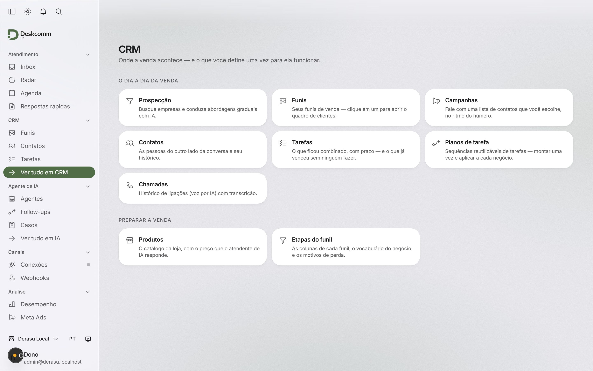
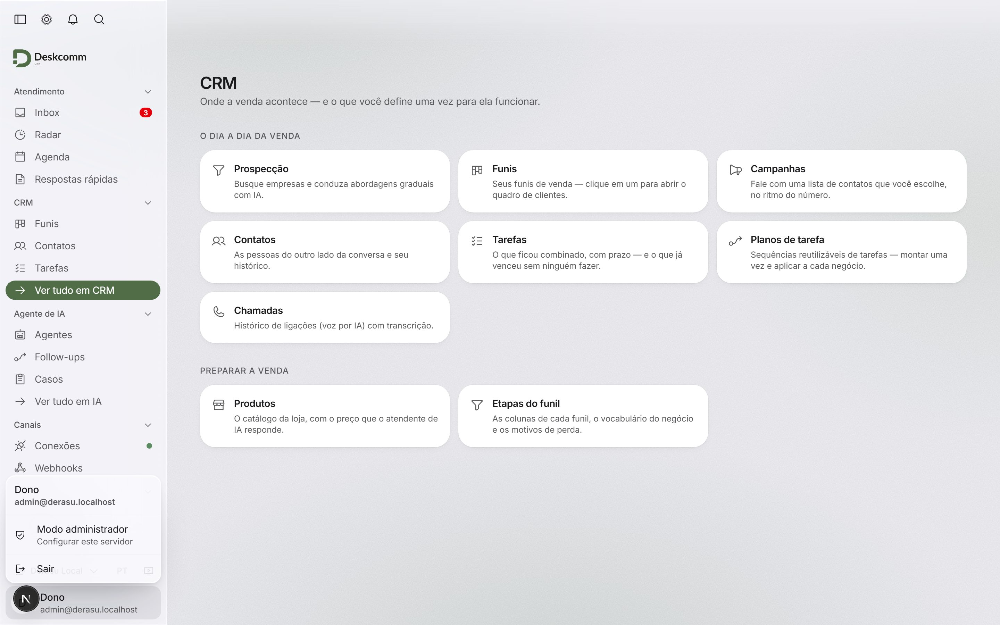
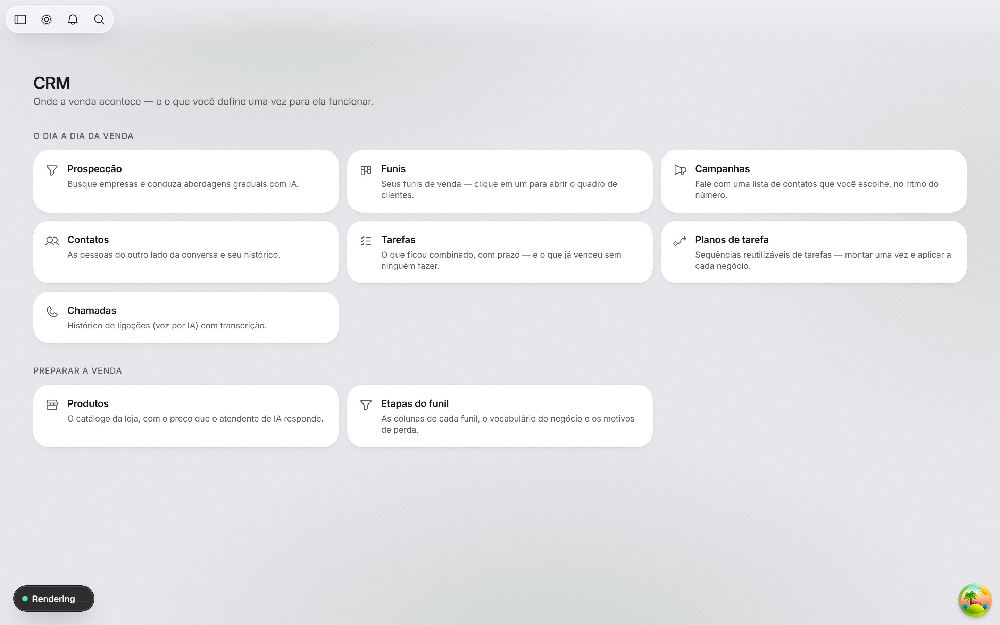
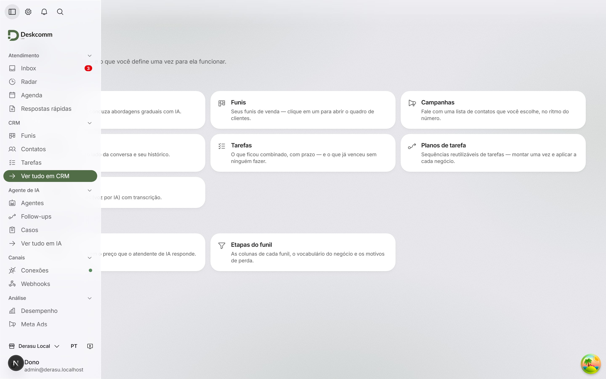
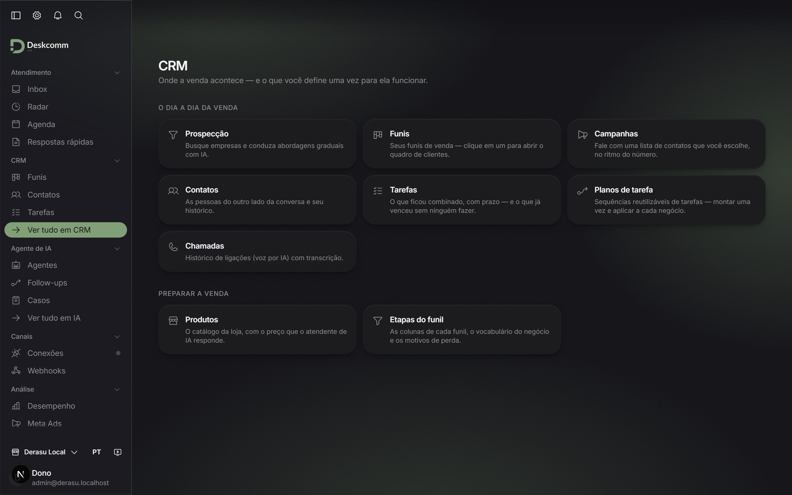
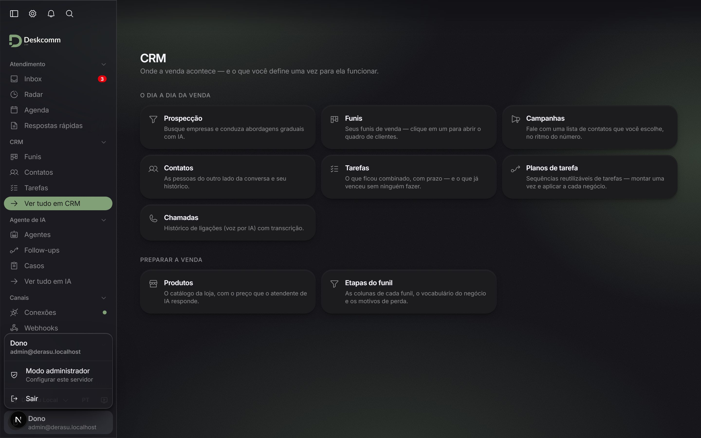
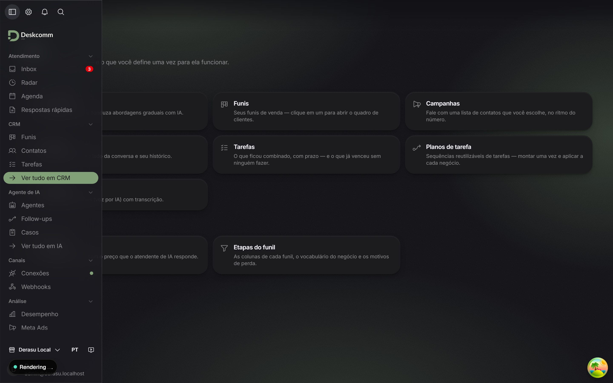
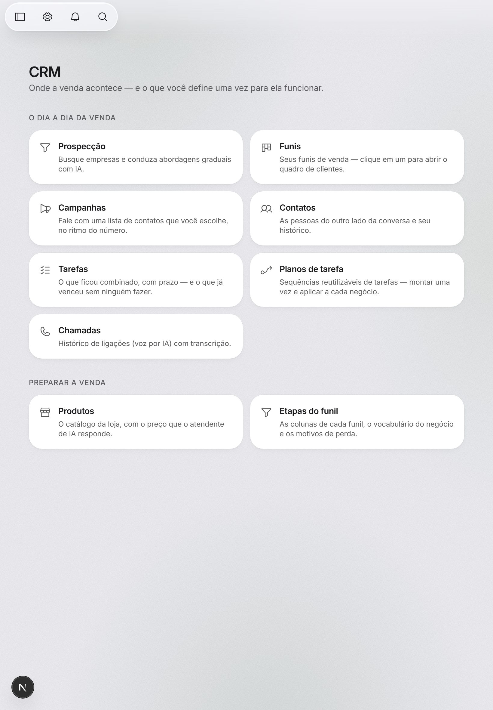
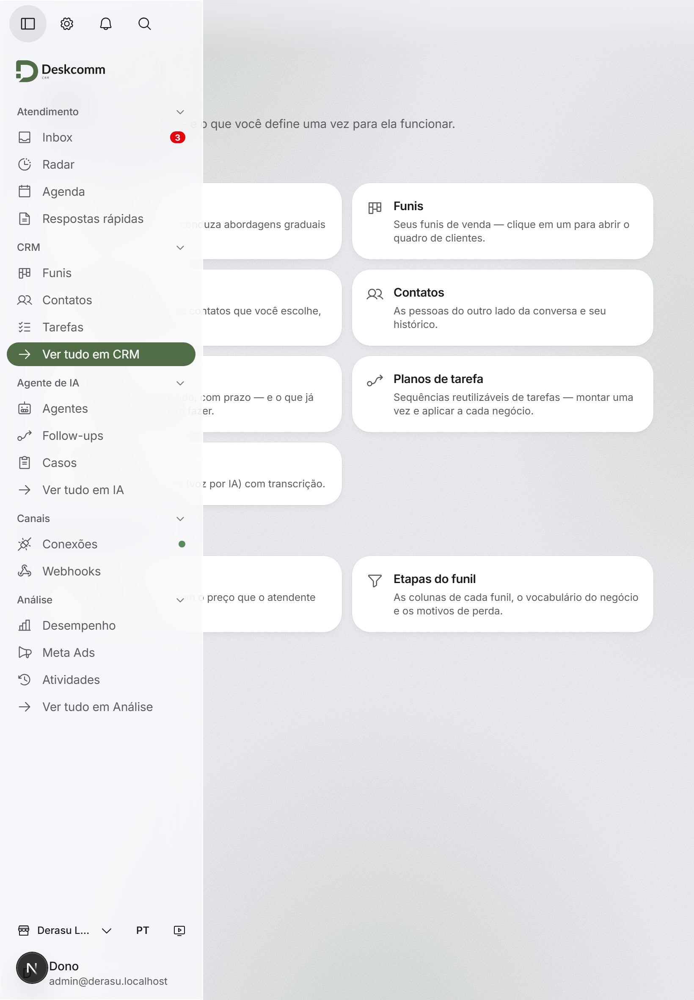

# Prova da barra lateral fixada ou solta — Derasu

Gerada por `derasu/scripts/prova-barra-lateral.mjs` (ADR 0004). As medidas de cada
estado (posição do ícone, presença da lâmina, deslocamento da espiada, folga do topo)
estão em [`medidas.json`](medidas.json).

## Desktop claro: barra fixada e encostada, com a cápsula do canto e o pé da barra

## Desktop claro: menu da conta, aberto para cima

## Barra solta: só a cápsula do canto, de vidro, sobre o conteúdo

## Espiada: a barra por cima do conteúdo, sem escurecer; o conteúdo não se move

## Desktop escuro: barra fixada e encostada, com a cápsula do canto e o pé da barra

## Desktop escuro: menu da conta, aberto para cima

## Desktop escuro: espiada

## Tablet de toque: sem barra fixada; a cápsula do canto sobre o conteúdo

## Tablet de toque: o toque no ícone abre a barra por cima

