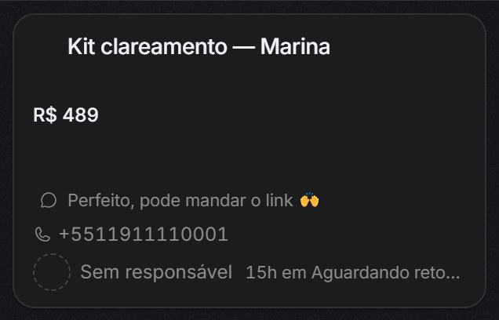
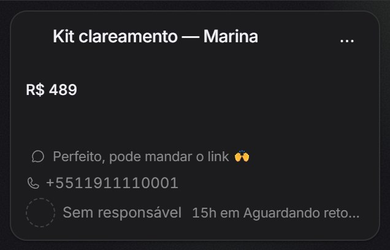

# Rodapé do cartão do funil — sem sobreposição

Defeito: com o nome da etapa longo, "Sem responsável" passava por baixo de
"15h em Carrinho abandonado" no rodapé do cartão (`components/kanban/KanbanCard.tsx`).

**A causa é do oficial, não da fonte.** A raiz do `OwnerBadge` não tinha
`min-w-0` (item flex não encolhe abaixo do conteúdo, então o `truncate` do
rótulo nunca agia) e o texto da etapa era `shrink-0 whitespace-nowrap`. Nenhum
dos dois lados cedia. Os arquivos do quadro são idênticos aos do
`melgarafael/DeskcommCRM` (`git diff upstream/main -- components/kanban` vazio).
A Inter da fork, mais larga que a Atkinson do oficial, só faz o defeito aparecer
com nomes de etapa mais curtos: com a Atkinson o seed já sobrepõe nos 2 cartões
de etapa "E2E Ramos 1792557914349" e, com etapa longa, em todos.

Conserto: o lado do responsável não encolhe até 65% do rodapé (`shrink-0
max-w-[65%]`, e o `OwnerBadge` com `min-w-0` trunca o rótulo acima disso); a
etapa trunca no fim (`min-w-0 truncate`, nome inteiro no `title`). Quem cede é a
etapa porque a coluna já a diz, e o tempo ("15h") vem antes e sobrevive ao corte.

## Medida (Playwright, `getBoundingClientRect`)

Script: `derasu/scripts/medir-rodape-do-cartao.mjs`. Para cada cartão, mede a
caixa do rótulo do responsável e a do texto da etapa; "intercepta" é
`rótulo.direita > etapa.esquerda` (as duas estão na mesma linha de 24 px). Cada
modo roda em desktop (1440×900) e celular (390×844), claro e escuro, com a Inter
da fork e com a Atkinson do oficial forçada — 8 casos × 7 cartões (5 do seed
`derasu/scripts/seed-conteudo-local.sql` + 2 de e2e). Dados crus em `*.json`.

| Modo                                                    | Cartões com sobreposição (de 56)                  |
| ------------------------------------------------------- | ------------------------------------------------- |
| antes, etapa do seed                                    | **28** (Inter: 5 de 7 por caso; Atkinson: 2 de 7) |
| depois, etapa do seed                                   | **0**                                             |
| antes, etapa longa ("Aguardando retorno do financeiro") | **56**                                            |
| depois, etapa longa                                     | **0**                                             |
| depois, etapa e responsável longos                      | **0**                                             |

Depois do conserto a folga mínima entre as caixas é **8 px** (o `gap-2`) em
todos os 168 cartões medidos, e o rótulo "Sem responsável" não trunca em nenhum
dos 112 cartões com o responsável real (etapa do seed ou longa); só a etapa trunca. Com o responsável longo
("Maria Aparecida dos Santos Figueiredo") os dois truncam, e continuam sem se
tocar.

O "antes" é o mesmo build com as propriedades do conserto desfeitas no DOM
(`min-width`, `max-width`, `flex-shrink`). Como controle, o código antigo
medido de verdade (antes de editar, no desktop) deu os mesmos números ao décimo
de pixel: rótulo até x=437,2, etapa desde x=432,7.

App em `next dev` com Supabase local (`baseline.sql` + dono do
`bootstrap-owner.ts`); o `next build` desta branch passou, mas o `next start`
exige Redis e WAHA, que ficam fora do trabalho visual no Windows.

## Antes, etapa do seed

O conserto desfeito no DOM (`--sem-conserto`).

## Depois, etapa do seed

Código desta branch.

## Antes, etapa longa

`--sem-conserto --etapa-longa`.

## Depois, etapa longa

`--etapa-longa`.

## Depois, etapa e responsável longos

`--etapa-longa --dono-longo`.

