# Prova de tela — derasu-conteudo

Gerado por `derasu/scripts/prova-de-tela.mjs`: claro/escuro × desktop/celular ×
transparência ligada/desligada (emulada pelo protocolo do Chrome). Valores lidos por
`getComputedStyle`; o detalhe completo está em `medidas.json`.

### app-pipelines-21fe892d-ed60-42cd-af7f-e074f4ad48c7_desktop_claro_vidro

tema `light`; transparência reduzida: não; fonte "Inter Derasu"; sem cartão; barra lateral `rgba(250, 250, 253, 0.6)` / `blur(22px) saturate(1.9)`; lâmina em (8, 8), 884px de altura, raio `22px`; cápsula do topo `rgba(250, 250, 253, 0.6)` / `blur(22px) saturate(1.9)`; botão com raio `9999px`; campo com raio `12px`.

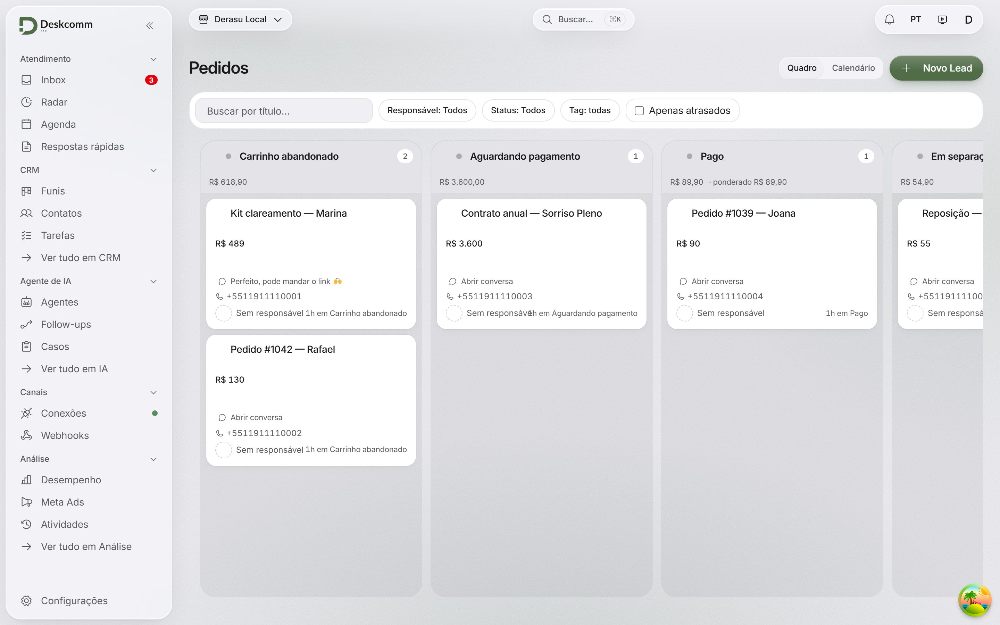

### app-pipelines-21fe892d-ed60-42cd-af7f-e074f4ad48c7_desktop_claro_vidro_dica

dica (tooltip): fundo `rgba(250, 250, 253, 0.78)`, texto `rgb(26, 26, 28)`, desfoque `blur(32px) saturate(1.9)`, raio `10px`.

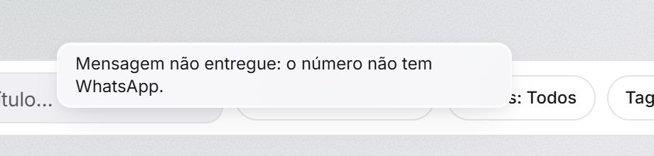

### app-pipelines-21fe892d-ed60-42cd-af7f-e074f4ad48c7_desktop_claro_vidro_menu

tema `light`; transparência reduzida: não; fonte "Inter Derasu"; sem cartão; barra lateral `rgba(250, 250, 253, 0.6)` / `blur(22px) saturate(1.9)`; lâmina em (8, 8), 884px de altura, raio `22px`; cápsula do topo `rgba(250, 250, 253, 0.6)` / `blur(22px) saturate(1.9)`; menu `rgba(250, 250, 253, 0.78)` / `blur(32px) saturate(1.9)`; botão com raio `9999px`; campo com raio `12px`.

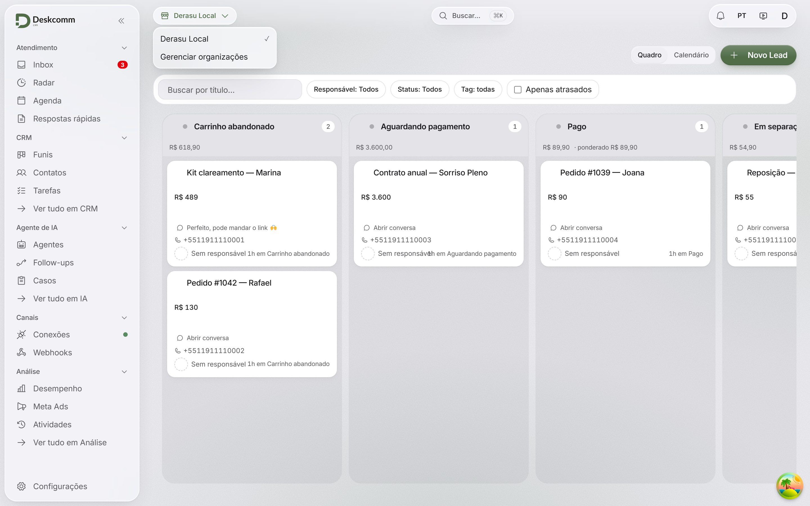

### app-inbox-id-d0000000-0000-4000-8000-000000000301_desktop_claro_vidro

tema `light`; transparência reduzida: não; fonte "Inter Derasu"; cartão `rgb(255, 255, 255)`; barra lateral `rgba(250, 250, 253, 0.6)` / `blur(22px) saturate(1.9)`; lâmina em (8, 8), 884px de altura, raio `22px`; cápsula do topo `rgba(250, 250, 253, 0.6)` / `blur(22px) saturate(1.9)`; botão com raio `9999px`; campo com raio `9999px`; abas: trilho `rgba(0, 0, 0, 0)`, raios `0px`/`0px`, gota `rgba(0, 0, 0, 0)` (opacidade 1, escala none).

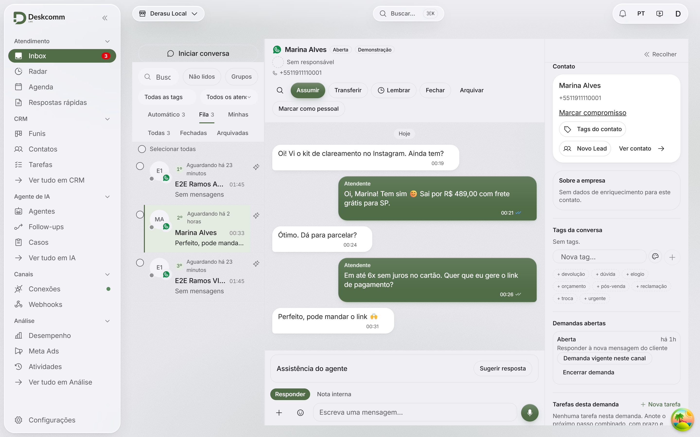

### app-audit_desktop_claro_vidro

tema `light`; transparência reduzida: não; fonte "Inter Derasu"; cartão `rgb(255, 255, 255)`; barra lateral `rgba(250, 250, 253, 0.6)` / `blur(22px) saturate(1.9)`; lâmina em (8, 8), 884px de altura, raio `22px`; cápsula do topo `rgba(250, 250, 253, 0.6)` / `blur(22px) saturate(1.9)`; campo com raio `12px`.

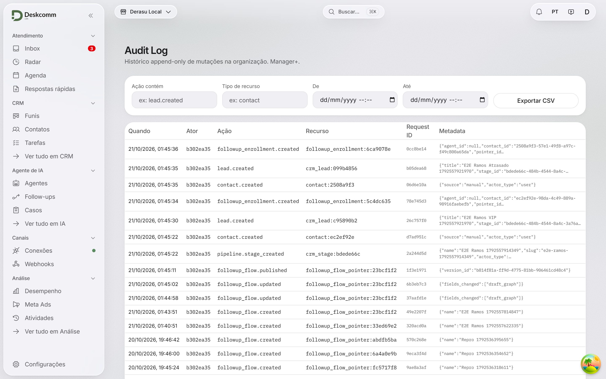

Conteúdo rolado por baixo do topo:

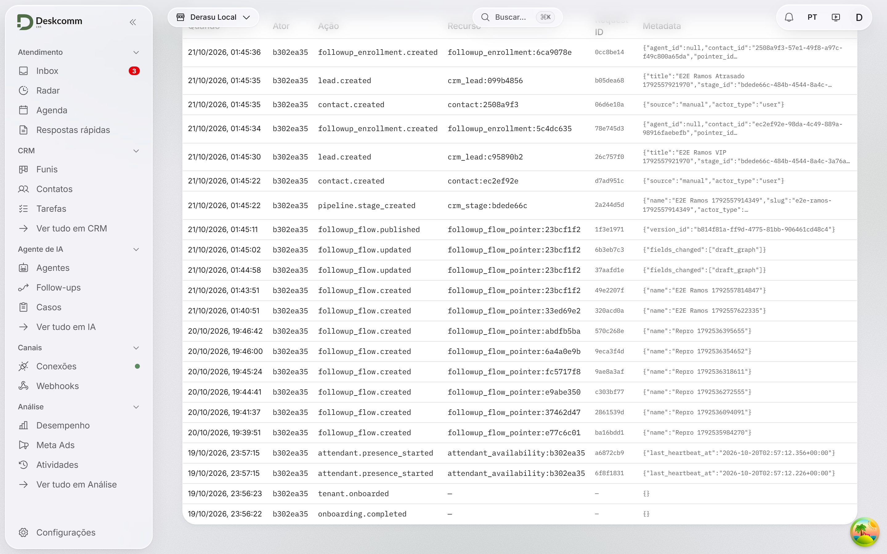

### app-pipelines-21fe892d-ed60-42cd-af7f-e074f4ad48c7_desktop_claro_sem-transparencia

tema `light`; transparência reduzida: sim; fonte "Inter Derasu"; sem cartão; barra lateral `rgb(255, 255, 255)` / `none`; lâmina em (8, 8), 884px de altura, raio `22px`; cápsula do topo `rgb(255, 255, 255)` / `none`; botão com raio `9999px`; campo com raio `12px`.

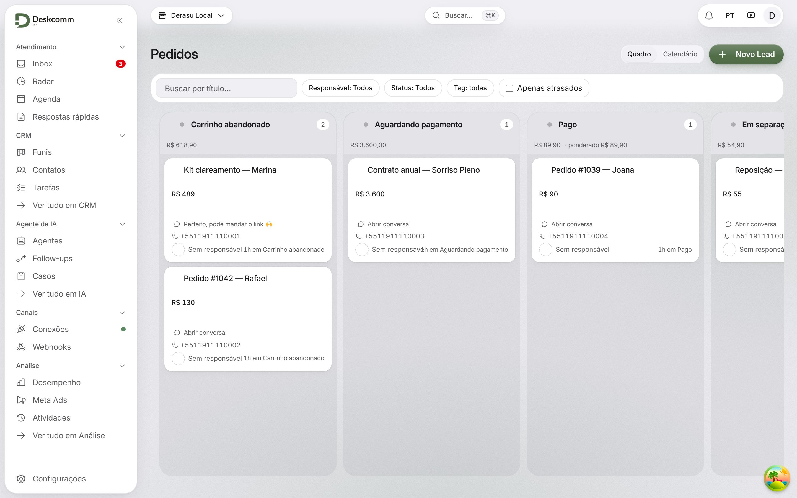

### app-pipelines-21fe892d-ed60-42cd-af7f-e074f4ad48c7_desktop_claro_sem-transparencia_dica

dica (tooltip): fundo `rgb(255, 255, 255)`, texto `rgb(26, 26, 28)`, desfoque `none`, raio `10px`.

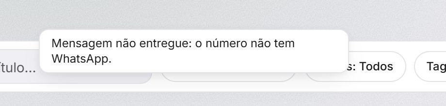

### app-pipelines-21fe892d-ed60-42cd-af7f-e074f4ad48c7_desktop_claro_sem-transparencia_menu

tema `light`; transparência reduzida: sim; fonte "Inter Derasu"; sem cartão; barra lateral `rgb(255, 255, 255)` / `none`; lâmina em (8, 8), 884px de altura, raio `22px`; cápsula do topo `rgb(255, 255, 255)` / `none`; menu `rgb(255, 255, 255)` / `none`; botão com raio `9999px`; campo com raio `12px`.

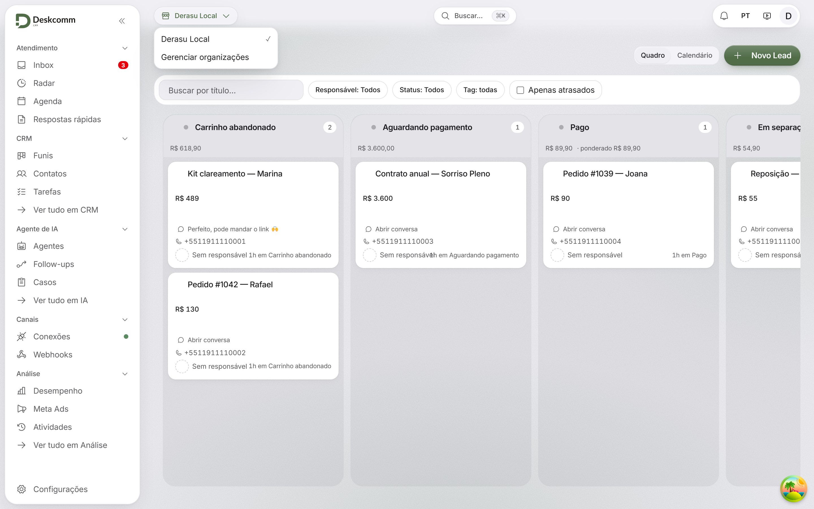

### app-inbox-id-d0000000-0000-4000-8000-000000000301_desktop_claro_sem-transparencia

tema `light`; transparência reduzida: sim; fonte "Inter Derasu"; cartão `rgb(255, 255, 255)`; barra lateral `rgb(255, 255, 255)` / `none`; lâmina em (8, 8), 884px de altura, raio `22px`; cápsula do topo `rgb(255, 255, 255)` / `none`; botão com raio `9999px`; campo com raio `9999px`; abas: trilho `rgba(0, 0, 0, 0)`, raios `0px`/`0px`, gota `rgba(0, 0, 0, 0)` (opacidade 1, escala none).

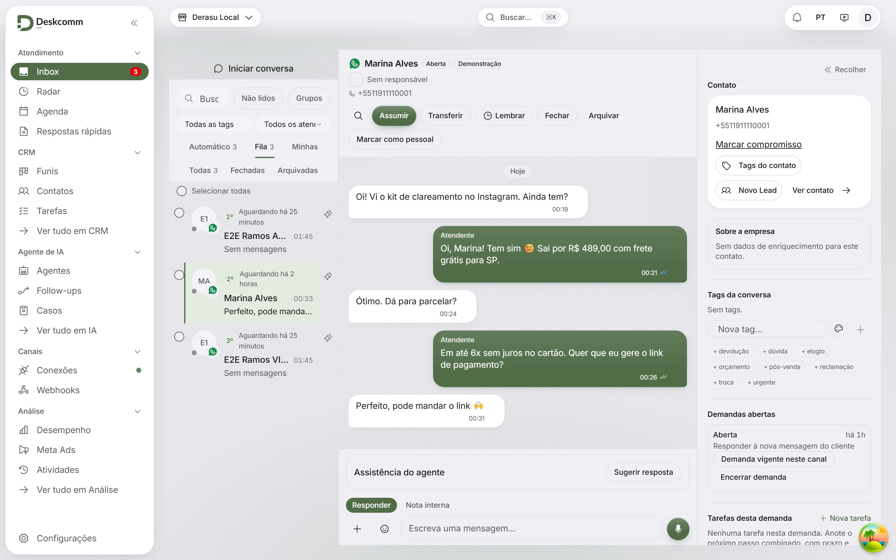

### app-audit_desktop_claro_sem-transparencia

tema `light`; transparência reduzida: sim; fonte "Inter Derasu"; cartão `rgb(255, 255, 255)`; barra lateral `rgb(255, 255, 255)` / `none`; lâmina em (8, 8), 884px de altura, raio `22px`; cápsula do topo `rgb(255, 255, 255)` / `none`; campo com raio `12px`.

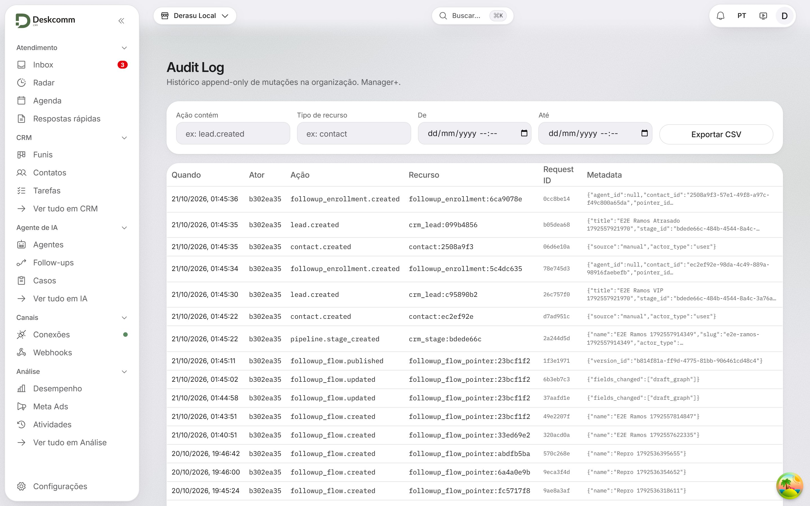

Conteúdo rolado por baixo do topo:

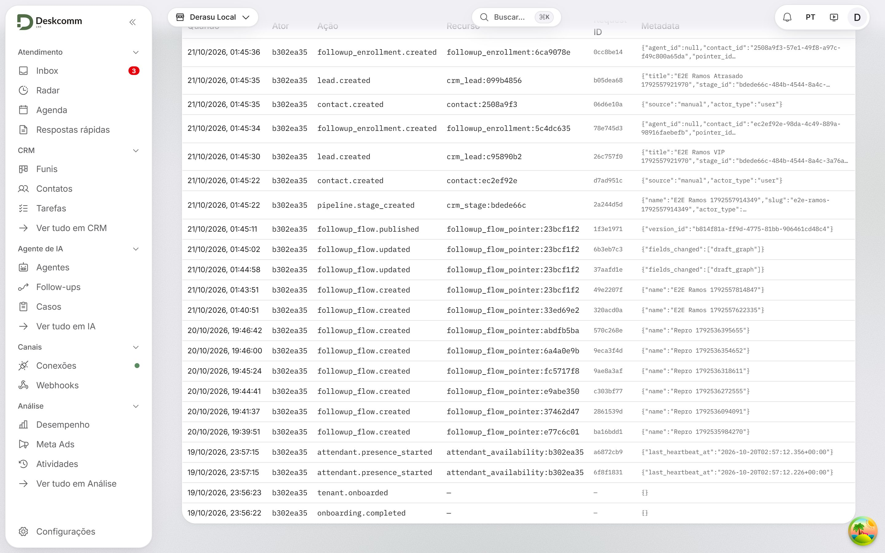

### app-pipelines-21fe892d-ed60-42cd-af7f-e074f4ad48c7_desktop_escuro_vidro

tema `dark`; transparência reduzida: não; fonte "Inter Derasu"; sem cartão; barra lateral `rgba(30, 30, 36, 0.56)` / `blur(22px) saturate(1.9)`; lâmina em (8, 8), 884px de altura, raio `22px`; cápsula do topo `rgba(30, 30, 36, 0.56)` / `blur(22px) saturate(1.9)`; botão com raio `9999px`; campo com raio `12px`.

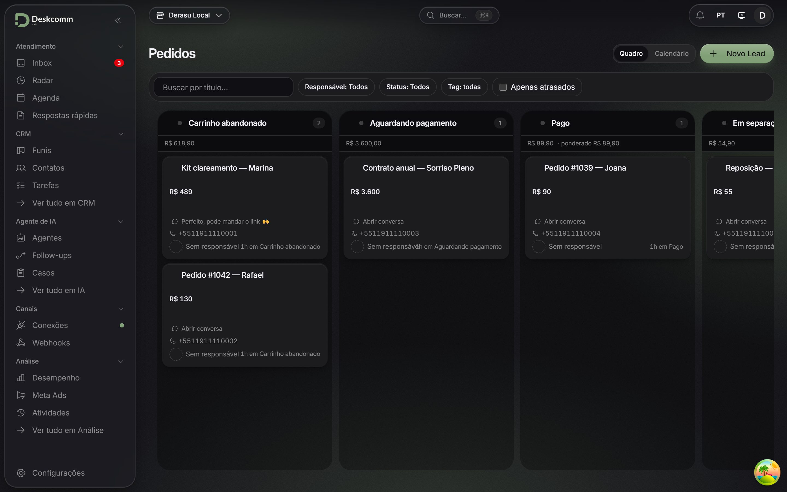

### app-pipelines-21fe892d-ed60-42cd-af7f-e074f4ad48c7_desktop_escuro_vidro_dica

dica (tooltip): fundo `rgba(28, 28, 33, 0.8)`, texto `rgb(243, 243, 248)`, desfoque `blur(32px) saturate(1.9)`, raio `10px`.

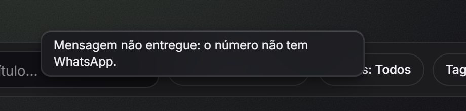

### app-pipelines-21fe892d-ed60-42cd-af7f-e074f4ad48c7_desktop_escuro_vidro_menu

tema `dark`; transparência reduzida: não; fonte "Inter Derasu"; sem cartão; barra lateral `rgba(30, 30, 36, 0.56)` / `blur(22px) saturate(1.9)`; lâmina em (8, 8), 884px de altura, raio `22px`; cápsula do topo `rgba(30, 30, 36, 0.56)` / `blur(22px) saturate(1.9)`; menu `rgba(28, 28, 33, 0.8)` / `blur(32px) saturate(1.9)`; botão com raio `9999px`; campo com raio `12px`.

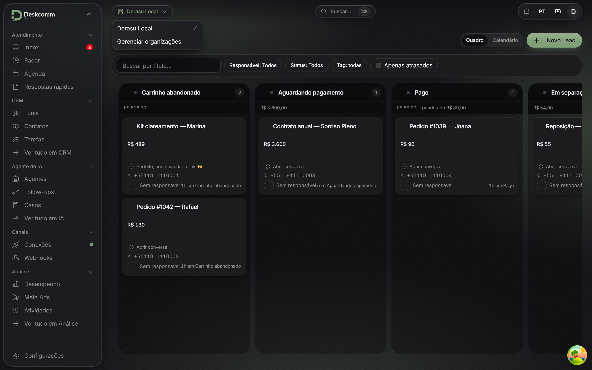

### app-inbox-id-d0000000-0000-4000-8000-000000000301_desktop_escuro_vidro

tema `dark`; transparência reduzida: não; fonte "Inter Derasu"; cartão `rgb(28, 28, 31)`; barra lateral `rgba(30, 30, 36, 0.56)` / `blur(22px) saturate(1.9)`; lâmina em (8, 8), 884px de altura, raio `22px`; cápsula do topo `rgba(30, 30, 36, 0.56)` / `blur(22px) saturate(1.9)`; botão com raio `9999px`; campo com raio `9999px`; abas: trilho `rgba(0, 0, 0, 0)`, raios `0px`/`0px`, gota `rgba(0, 0, 0, 0)` (opacidade 1, escala none).

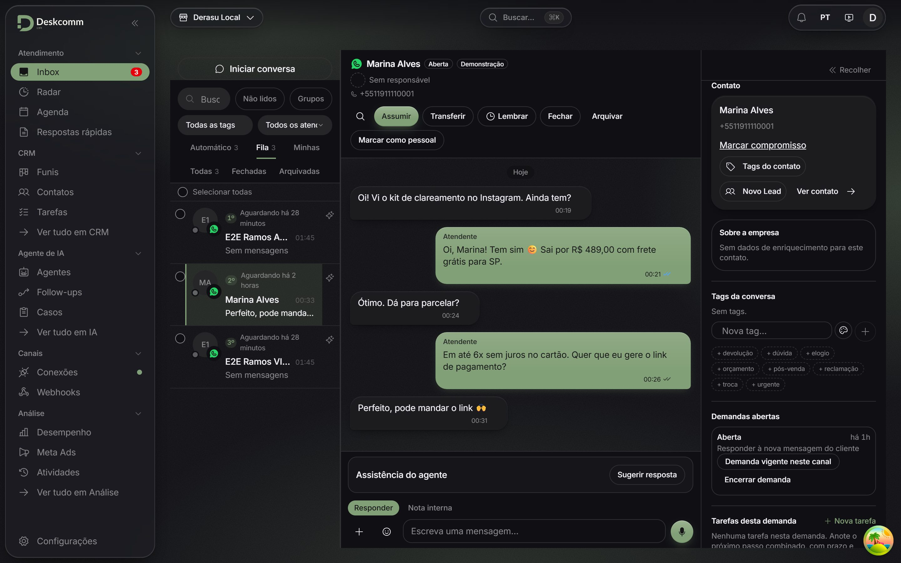

### app-audit_desktop_escuro_vidro

tema `dark`; transparência reduzida: não; fonte "Inter Derasu"; cartão `rgb(28, 28, 31)`; barra lateral `rgba(30, 30, 36, 0.56)` / `blur(22px) saturate(1.9)`; lâmina em (8, 8), 884px de altura, raio `22px`; cápsula do topo `rgba(30, 30, 36, 0.56)` / `blur(22px) saturate(1.9)`; campo com raio `12px`.

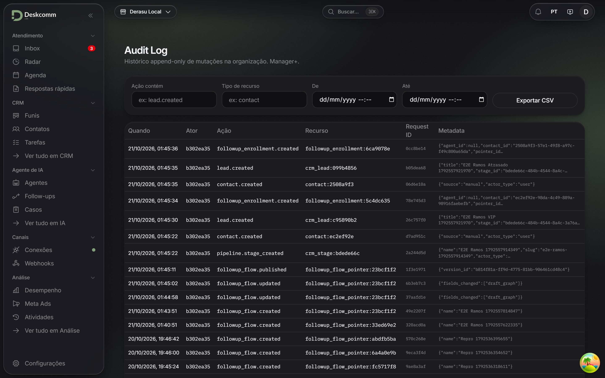

Conteúdo rolado por baixo do topo:

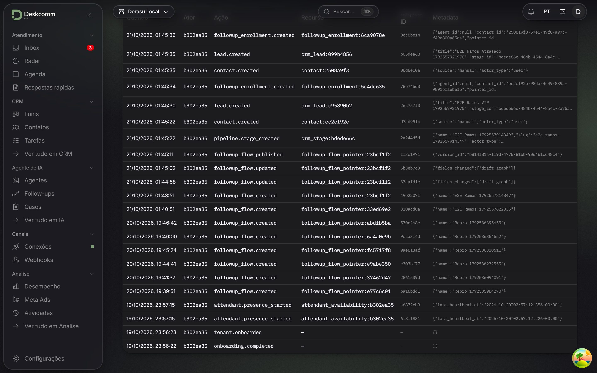

### app-pipelines-21fe892d-ed60-42cd-af7f-e074f4ad48c7_desktop_escuro_sem-transparencia

tema `dark`; transparência reduzida: sim; fonte "Inter Derasu"; sem cartão; barra lateral `rgb(28, 28, 31)` / `none`; lâmina em (8, 8), 884px de altura, raio `22px`; cápsula do topo `rgb(28, 28, 31)` / `none`; botão com raio `9999px`; campo com raio `12px`.

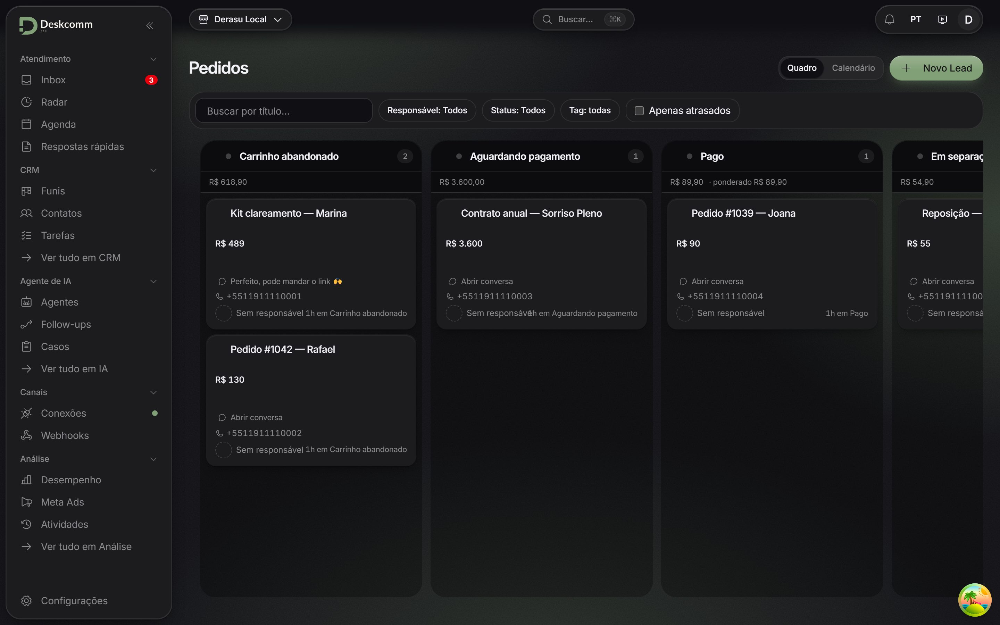

### app-pipelines-21fe892d-ed60-42cd-af7f-e074f4ad48c7_desktop_escuro_sem-transparencia_dica

dica (tooltip): fundo `rgb(28, 28, 31)`, texto `rgb(243, 243, 248)`, desfoque `none`, raio `10px`.

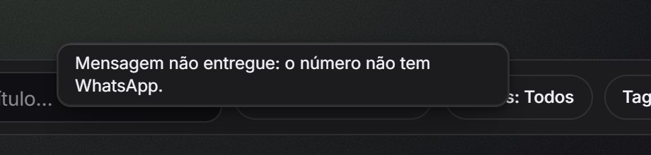

### app-pipelines-21fe892d-ed60-42cd-af7f-e074f4ad48c7_desktop_escuro_sem-transparencia_menu

tema `dark`; transparência reduzida: sim; fonte "Inter Derasu"; sem cartão; barra lateral `rgb(28, 28, 31)` / `none`; lâmina em (8, 8), 884px de altura, raio `22px`; cápsula do topo `rgb(28, 28, 31)` / `none`; menu `rgb(28, 28, 31)` / `none`; botão com raio `9999px`; campo com raio `12px`.

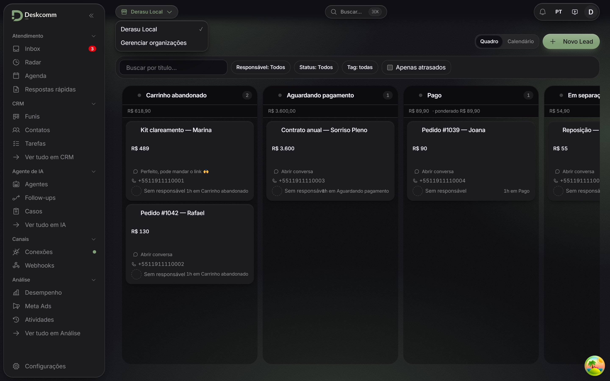

### app-inbox-id-d0000000-0000-4000-8000-000000000301_desktop_escuro_sem-transparencia

tema `dark`; transparência reduzida: sim; fonte "Inter Derasu"; cartão `rgb(28, 28, 31)`; barra lateral `rgb(28, 28, 31)` / `none`; lâmina em (8, 8), 884px de altura, raio `22px`; cápsula do topo `rgb(28, 28, 31)` / `none`; botão com raio `9999px`; campo com raio `9999px`; abas: trilho `rgba(0, 0, 0, 0)`, raios `0px`/`0px`, gota `rgba(0, 0, 0, 0)` (opacidade 1, escala none).

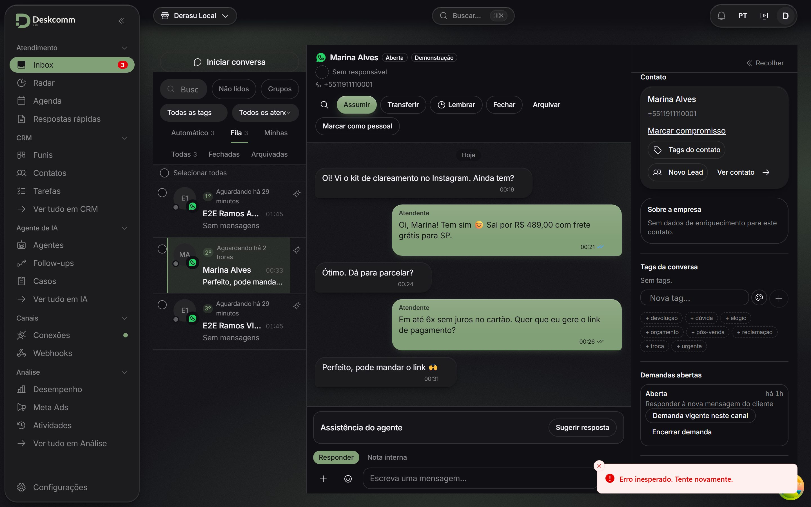

### app-audit_desktop_escuro_sem-transparencia

tema `dark`; transparência reduzida: sim; fonte "Inter Derasu"; cartão `rgb(28, 28, 31)`; barra lateral `rgb(28, 28, 31)` / `none`; lâmina em (8, 8), 884px de altura, raio `22px`; cápsula do topo `rgb(28, 28, 31)` / `none`; campo com raio `12px`.

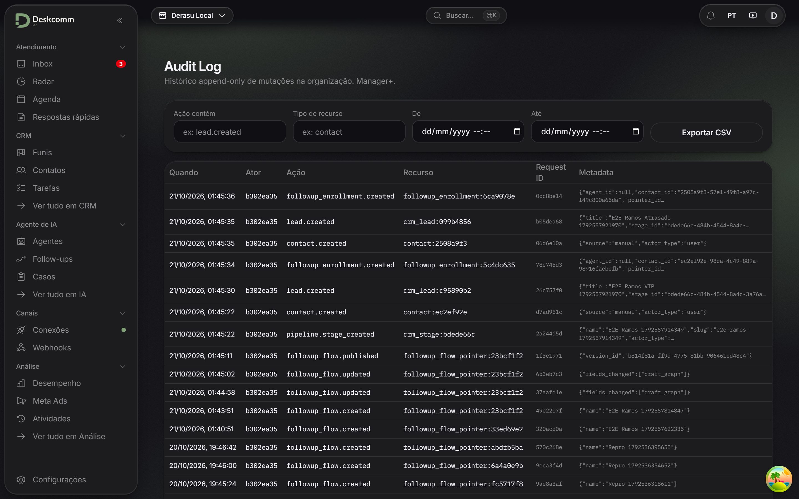

Conteúdo rolado por baixo do topo:

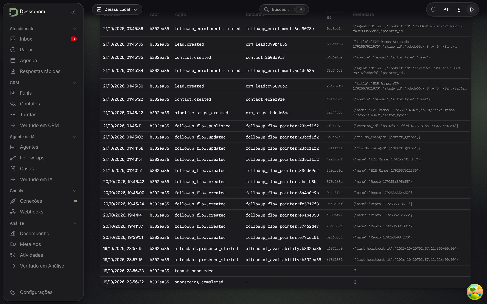

### app-pipelines-21fe892d-ed60-42cd-af7f-e074f4ad48c7_celular_claro_vidro

tema `light`; transparência reduzida: não; fonte "Inter Derasu"; sem cartão; barra lateral `rgba(250, 250, 253, 0.6)` / `blur(22px) saturate(1.9)`; cápsula do topo `rgba(250, 250, 253, 0.6)` / `blur(22px) saturate(1.9)`; barra de abas: nav de 64px a 0px do fundo, cápsula de 366×55px, gota escondida, main desconta `64px`; botão com raio `9999px`; campo com raio `12px`.

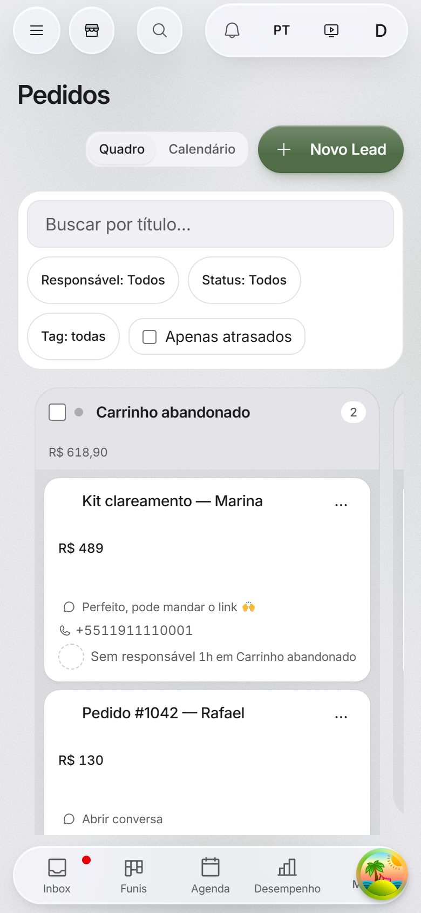

### app-inbox-id-d0000000-0000-4000-8000-000000000301_celular_claro_vidro

tema `light`; transparência reduzida: não; fonte "Inter Derasu"; cartão `rgb(255, 255, 255)`; barra lateral `rgba(250, 250, 253, 0.6)` / `blur(22px) saturate(1.9)`; cápsula do topo `rgba(250, 250, 253, 0.6)` / `blur(22px) saturate(1.9)`; barra de abas: nav de 64px a 0px do fundo, cápsula de 366×55px, gota em `0%`, main desconta `64px`; botão com raio `9999px`; campo com raio `9999px`; abas: trilho `rgba(0, 0, 0, 0)`, raios `0px`/`0px`, gota `rgba(0, 0, 0, 0)` (opacidade 1, escala none).

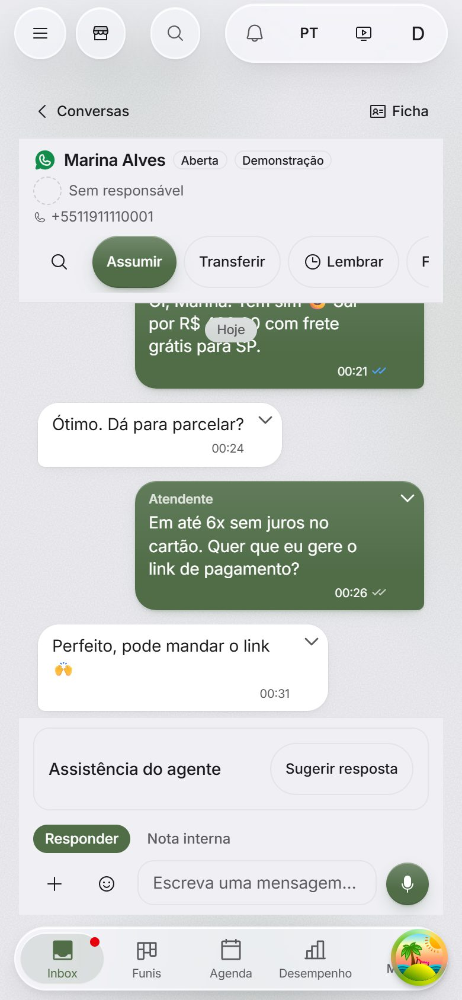

### app-audit_celular_claro_vidro

tema `light`; transparência reduzida: não; fonte "Inter Derasu"; cartão `rgb(255, 255, 255)`; barra lateral `rgba(250, 250, 253, 0.6)` / `blur(22px) saturate(1.9)`; cápsula do topo `rgba(250, 250, 253, 0.6)` / `blur(22px) saturate(1.9)`; barra de abas: nav de 64px a 0px do fundo, cápsula de 366×55px, gota escondida, main desconta `64px`; campo com raio `12px`.

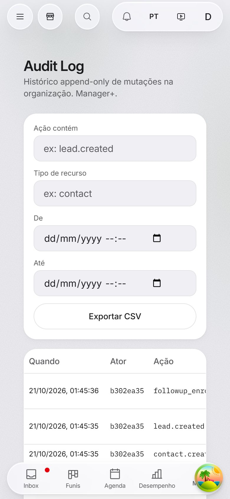

Conteúdo rolado por baixo do topo:

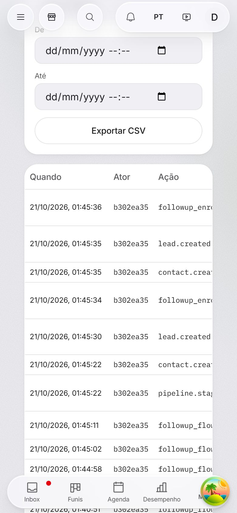

### app-pipelines-21fe892d-ed60-42cd-af7f-e074f4ad48c7_celular_claro_sem-transparencia

tema `light`; transparência reduzida: sim; fonte "Inter Derasu"; sem cartão; barra lateral `rgb(255, 255, 255)` / `none`; cápsula do topo `rgb(255, 255, 255)` / `none`; barra de abas: nav de 64px a 0px do fundo, cápsula de 366×55px, gota escondida, main desconta `64px`; botão com raio `9999px`; campo com raio `12px`.

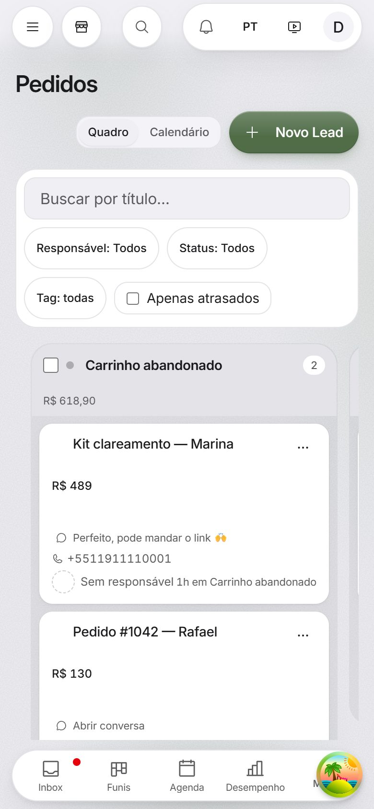

### app-inbox-id-d0000000-0000-4000-8000-000000000301_celular_claro_sem-transparencia

tema `light`; transparência reduzida: sim; fonte "Inter Derasu"; cartão `rgb(255, 255, 255)`; barra lateral `rgb(255, 255, 255)` / `none`; cápsula do topo `rgb(255, 255, 255)` / `none`; barra de abas: nav de 64px a 0px do fundo, cápsula de 366×55px, gota em `0%`, main desconta `64px`; botão com raio `9999px`; campo com raio `9999px`; abas: trilho `rgba(0, 0, 0, 0)`, raios `0px`/`0px`, gota `rgba(0, 0, 0, 0)` (opacidade 1, escala none).

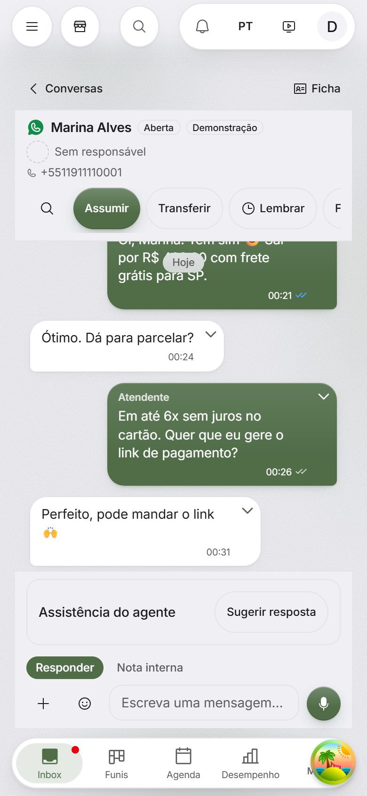

### app-audit_celular_claro_sem-transparencia

tema `light`; transparência reduzida: sim; fonte "Inter Derasu"; cartão `rgb(255, 255, 255)`; barra lateral `rgb(255, 255, 255)` / `none`; cápsula do topo `rgb(255, 255, 255)` / `none`; barra de abas: nav de 64px a 0px do fundo, cápsula de 366×55px, gota escondida, main desconta `64px`; campo com raio `12px`.

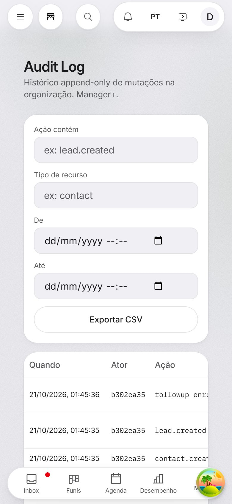

Conteúdo rolado por baixo do topo:

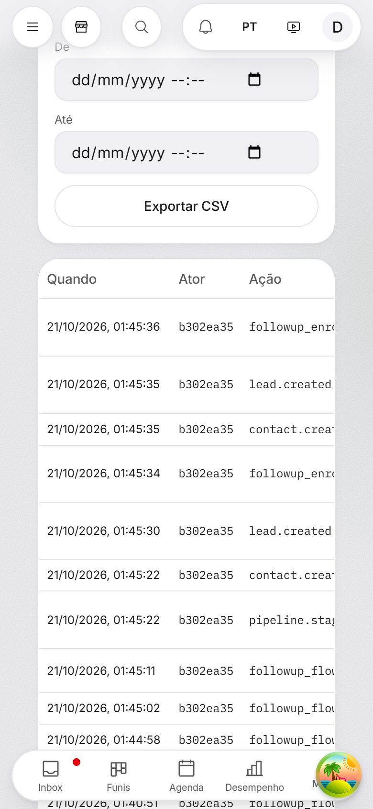

### app-pipelines-21fe892d-ed60-42cd-af7f-e074f4ad48c7_celular_escuro_vidro

tema `dark`; transparência reduzida: não; fonte "Inter Derasu"; sem cartão; barra lateral `rgba(30, 30, 36, 0.56)` / `blur(22px) saturate(1.9)`; cápsula do topo `rgba(30, 30, 36, 0.56)` / `blur(22px) saturate(1.9)`; barra de abas: nav de 64px a 0px do fundo, cápsula de 366×55px, gota escondida, main desconta `64px`; botão com raio `9999px`; campo com raio `12px`.

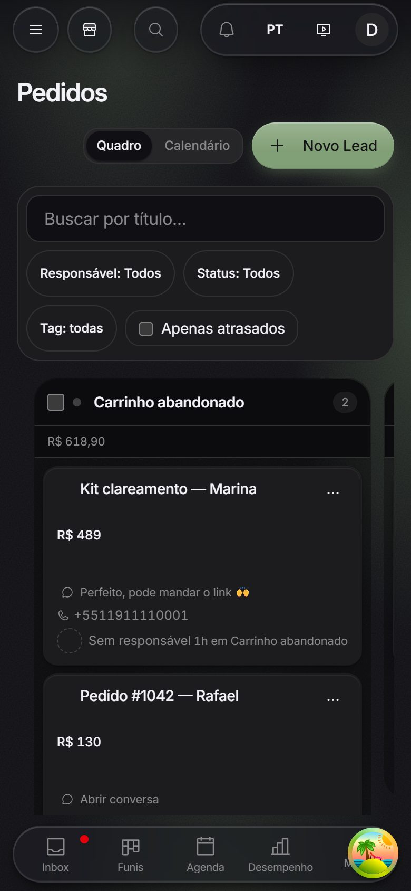

### app-inbox-id-d0000000-0000-4000-8000-000000000301_celular_escuro_vidro

tema `dark`; transparência reduzida: não; fonte "Inter Derasu"; cartão `rgb(28, 28, 31)`; barra lateral `rgba(30, 30, 36, 0.56)` / `blur(22px) saturate(1.9)`; cápsula do topo `rgba(30, 30, 36, 0.56)` / `blur(22px) saturate(1.9)`; barra de abas: nav de 64px a 0px do fundo, cápsula de 366×55px, gota em `0%`, main desconta `64px`; botão com raio `9999px`; campo com raio `9999px`; abas: trilho `rgba(0, 0, 0, 0)`, raios `0px`/`0px`, gota `rgba(0, 0, 0, 0)` (opacidade 1, escala none).

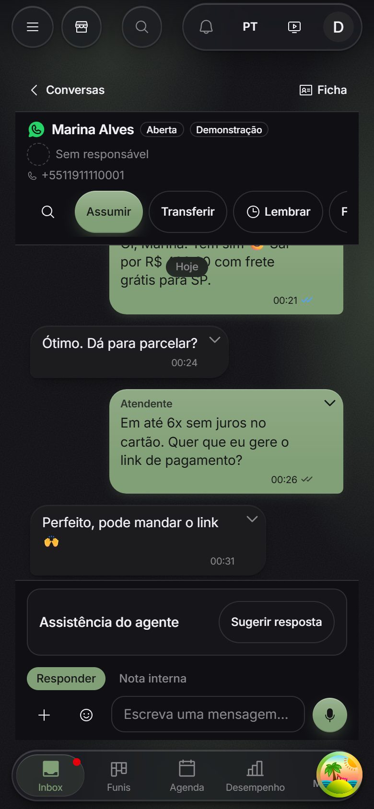

### app-audit_celular_escuro_vidro

tema `dark`; transparência reduzida: não; fonte "Inter Derasu"; cartão `rgb(28, 28, 31)`; barra lateral `rgba(30, 30, 36, 0.56)` / `blur(22px) saturate(1.9)`; cápsula do topo `rgba(30, 30, 36, 0.56)` / `blur(22px) saturate(1.9)`; barra de abas: nav de 64px a 0px do fundo, cápsula de 366×55px, gota escondida, main desconta `64px`; campo com raio `12px`.

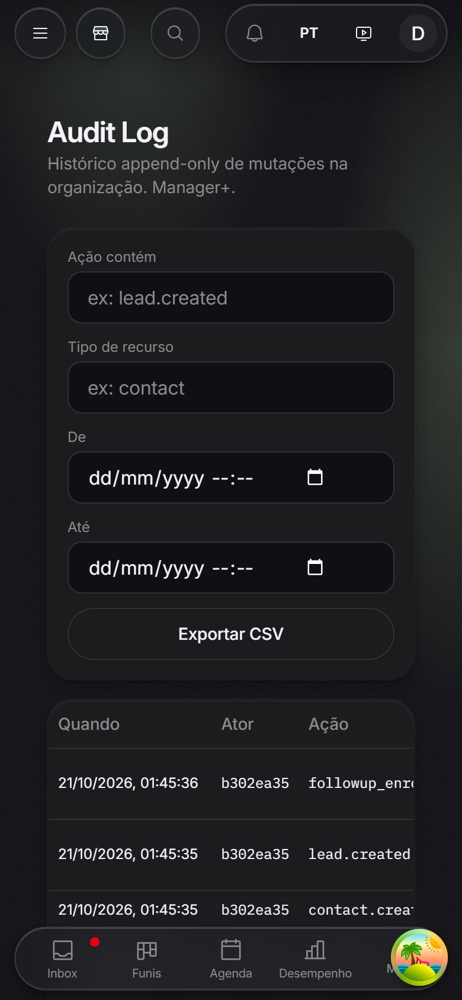

Conteúdo rolado por baixo do topo:

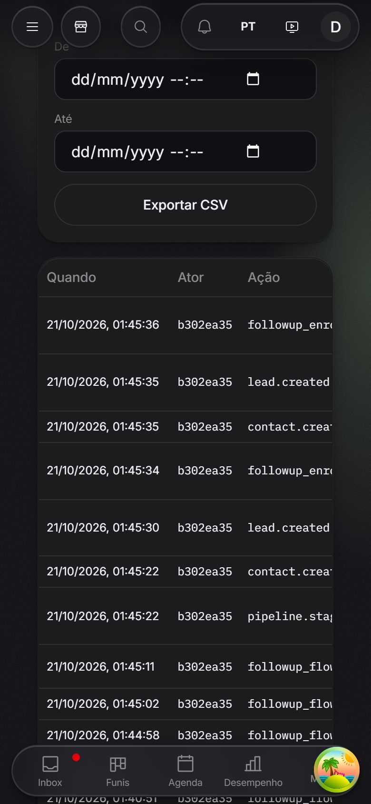

### app-pipelines-21fe892d-ed60-42cd-af7f-e074f4ad48c7_celular_escuro_sem-transparencia

tema `dark`; transparência reduzida: sim; fonte "Inter Derasu"; sem cartão; barra lateral `rgb(28, 28, 31)` / `none`; cápsula do topo `rgb(28, 28, 31)` / `none`; barra de abas: nav de 64px a 0px do fundo, cápsula de 366×55px, gota escondida, main desconta `64px`; botão com raio `9999px`; campo com raio `12px`.

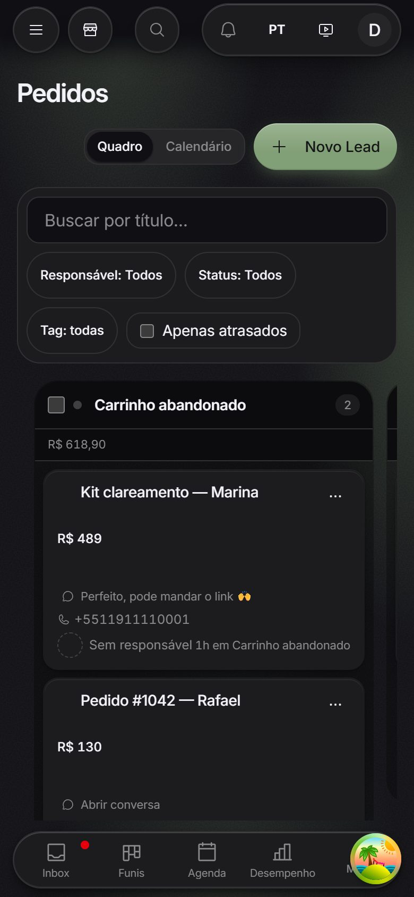

### app-inbox-id-d0000000-0000-4000-8000-000000000301_celular_escuro_sem-transparencia

tema `dark`; transparência reduzida: sim; fonte "Inter Derasu"; cartão `rgb(28, 28, 31)`; barra lateral `rgb(28, 28, 31)` / `none`; cápsula do topo `rgb(28, 28, 31)` / `none`; barra de abas: nav de 64px a 0px do fundo, cápsula de 366×55px, gota em `0%`, main desconta `64px`; botão com raio `9999px`; campo com raio `9999px`; abas: trilho `rgba(0, 0, 0, 0)`, raios `0px`/`0px`, gota `rgba(0, 0, 0, 0)` (opacidade 1, escala none).

### app-audit_celular_escuro_sem-transparencia

tema `dark`; transparência reduzida: sim; fonte "Inter Derasu"; cartão `rgb(28, 28, 31)`; barra lateral `rgb(28, 28, 31)` / `none`; cápsula do topo `rgb(28, 28, 31)` / `none`; barra de abas: nav de 64px a 0px do fundo, cápsula de 366×55px, gota escondida, main desconta `64px`; campo com raio `12px`.

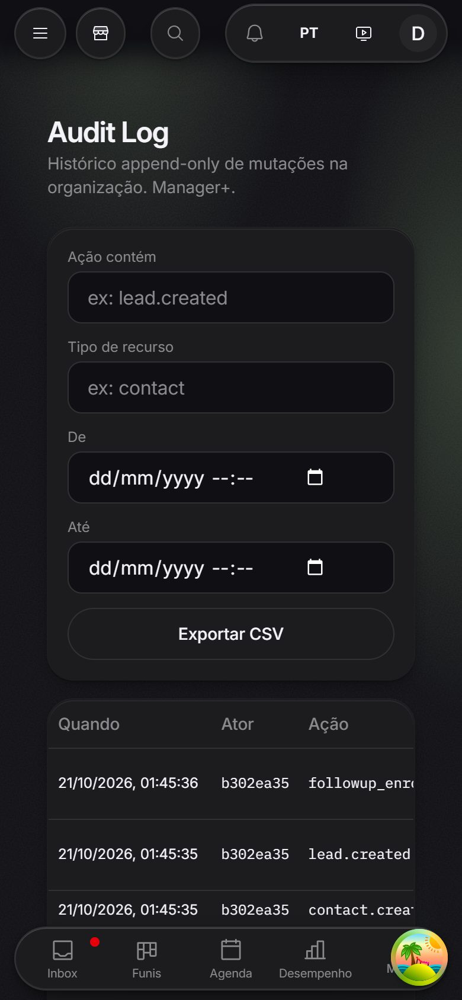

Conteúdo rolado por baixo do topo:

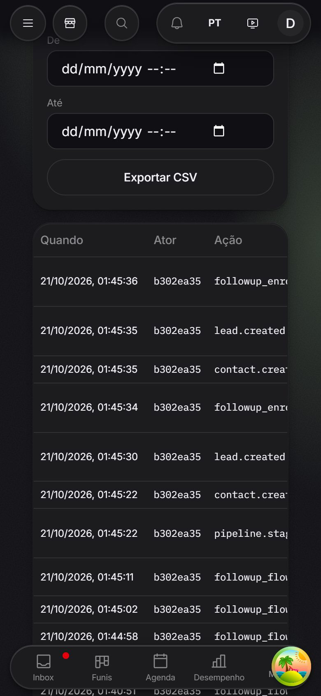
