# Prova de tela — derasu-fundacao

Gerado por `derasu/scripts/prova-de-tela.mjs`: claro/escuro × desktop/celular ×
transparência ligada/desligada (emulada pelo protocolo do Chrome). Valores lidos por
`getComputedStyle`; o detalhe completo está em `medidas.json`.

### app-crm_desktop_claro_vidro

tema `light`; transparência reduzida: não; fonte "Inter Derasu"; cartão `rgb(255, 255, 255)`; barra lateral `rgba(250, 250, 253, 0.6)` / `blur(22px) saturate(1.9)`.

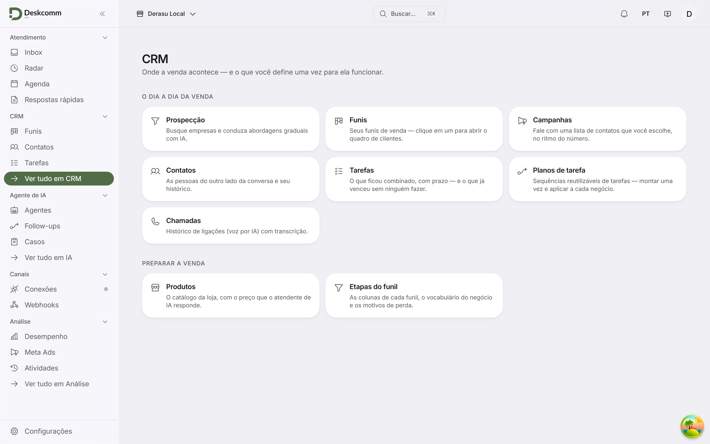

### app-crm_desktop_claro_vidro_menu

tema `light`; transparência reduzida: não; fonte "Inter Derasu"; cartão `rgb(255, 255, 255)`; barra lateral `rgba(250, 250, 253, 0.6)` / `blur(22px) saturate(1.9)`; menu `rgba(250, 250, 253, 0.78)` / `blur(32px) saturate(1.9)`.

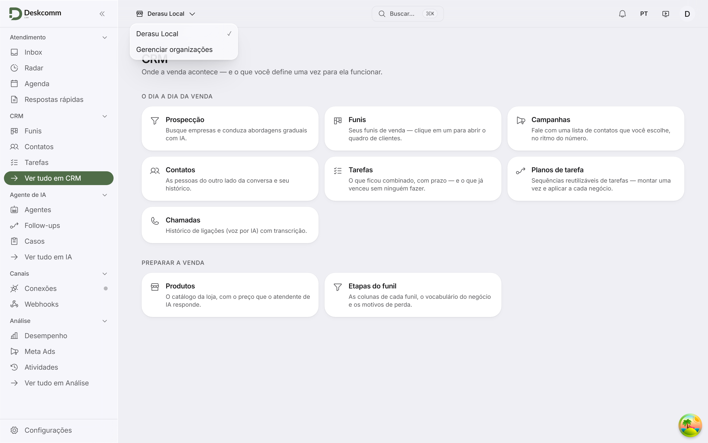

### app-inbox_desktop_claro_vidro

tema `light`; transparência reduzida: não; fonte "Inter Derasu"; sem cartão; barra lateral `rgba(250, 250, 253, 0.6)` / `blur(22px) saturate(1.9)`.

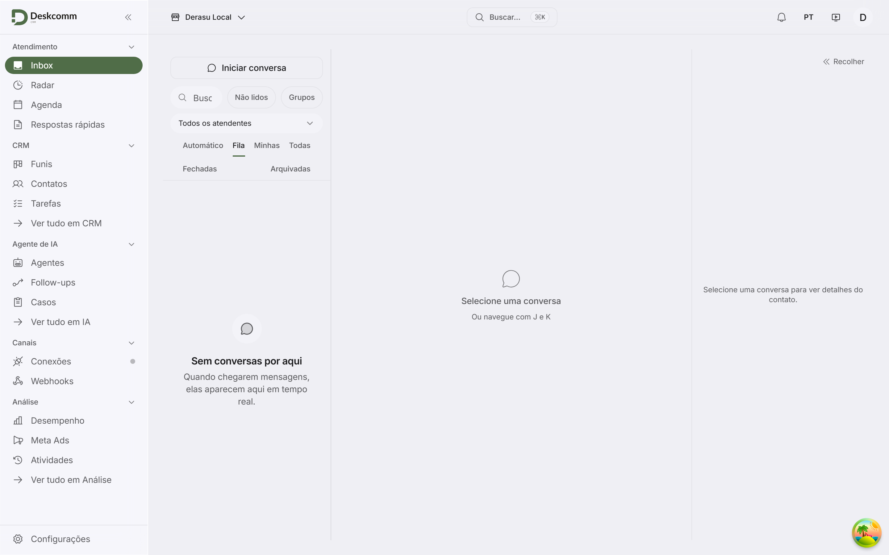

### app-crm_desktop_claro_sem-transparencia

tema `light`; transparência reduzida: sim; fonte "Inter Derasu"; cartão `rgb(255, 255, 255)`; barra lateral `rgb(255, 255, 255)` / `none`.

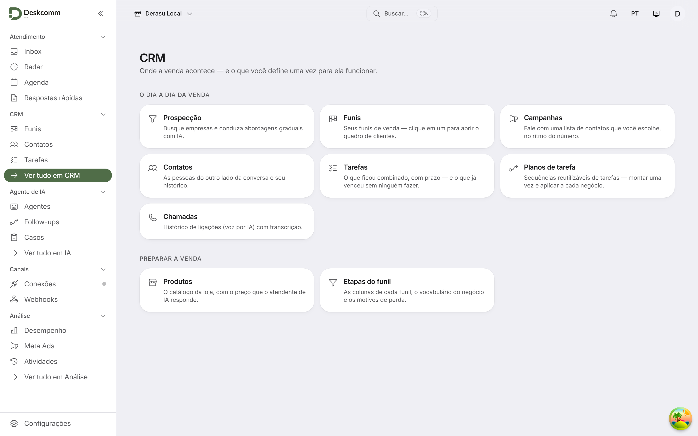

### app-crm_desktop_claro_sem-transparencia_menu

tema `light`; transparência reduzida: sim; fonte "Inter Derasu"; cartão `rgb(255, 255, 255)`; barra lateral `rgb(255, 255, 255)` / `none`; menu `rgb(255, 255, 255)` / `none`.

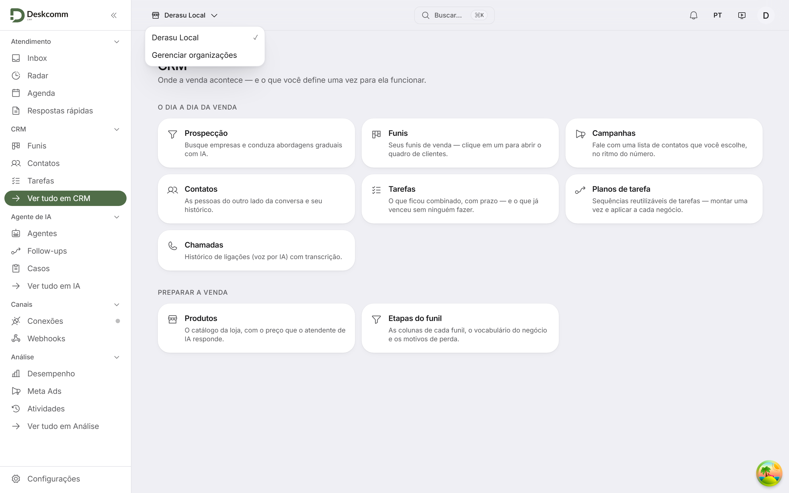

### app-inbox_desktop_claro_sem-transparencia

tema `light`; transparência reduzida: sim; fonte "Inter Derasu"; sem cartão; barra lateral `rgb(255, 255, 255)` / `none`.

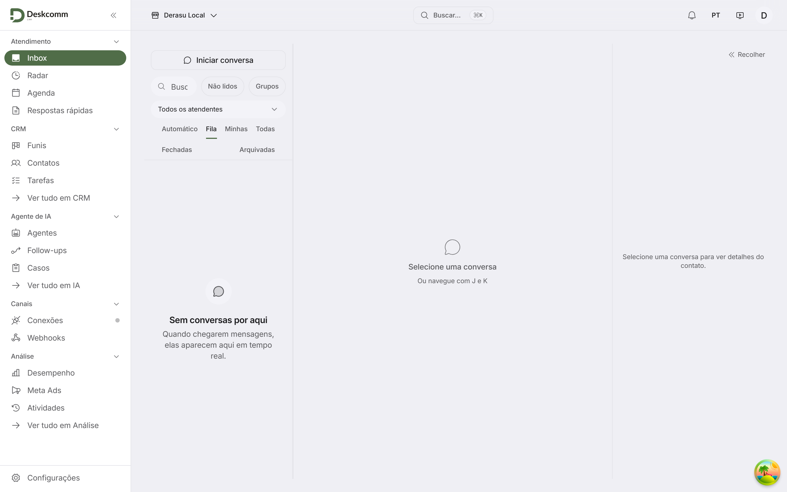

### app-crm_desktop_escuro_vidro

tema `dark`; transparência reduzida: não; fonte "Inter Derasu"; cartão `rgb(28, 28, 31)`; barra lateral `rgba(30, 30, 36, 0.56)` / `blur(22px) saturate(1.9)`.

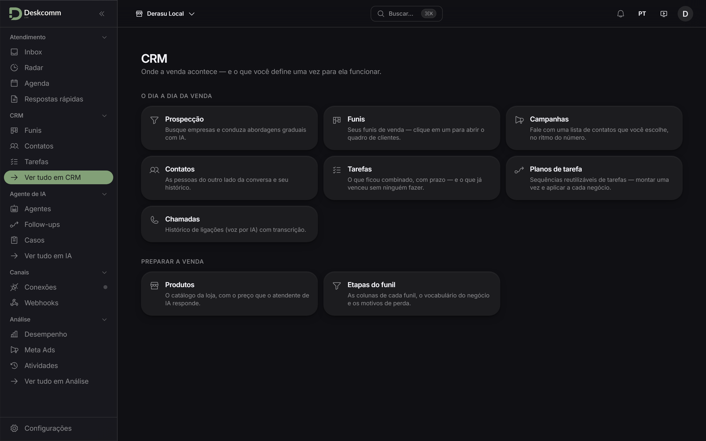

### app-crm_desktop_escuro_vidro_menu

tema `dark`; transparência reduzida: não; fonte "Inter Derasu"; cartão `rgb(28, 28, 31)`; barra lateral `rgba(30, 30, 36, 0.56)` / `blur(22px) saturate(1.9)`; menu `rgba(28, 28, 33, 0.8)` / `blur(32px) saturate(1.9)`.

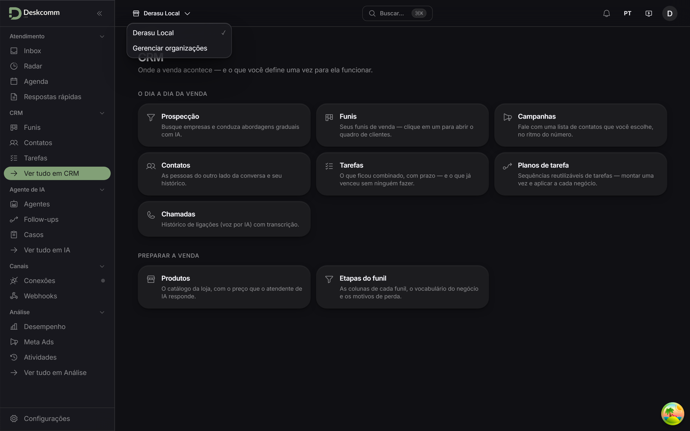

### app-inbox_desktop_escuro_vidro

tema `dark`; transparência reduzida: não; fonte "Inter Derasu"; sem cartão; barra lateral `rgba(30, 30, 36, 0.56)` / `blur(22px) saturate(1.9)`.

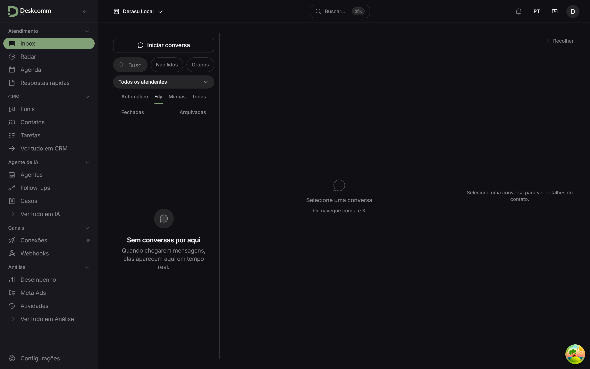

### app-crm_desktop_escuro_sem-transparencia

tema `dark`; transparência reduzida: sim; fonte "Inter Derasu"; cartão `rgb(28, 28, 31)`; barra lateral `rgb(28, 28, 31)` / `none`.

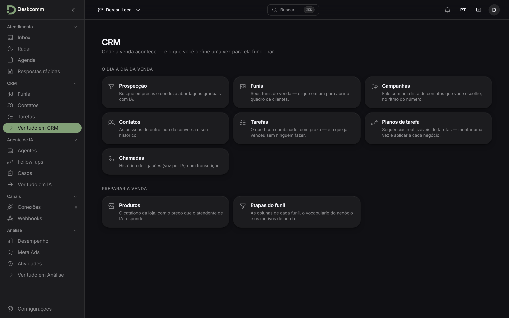

### app-crm_desktop_escuro_sem-transparencia_menu

tema `dark`; transparência reduzida: sim; fonte "Inter Derasu"; cartão `rgb(28, 28, 31)`; barra lateral `rgb(28, 28, 31)` / `none`; menu `rgb(28, 28, 31)` / `none`.

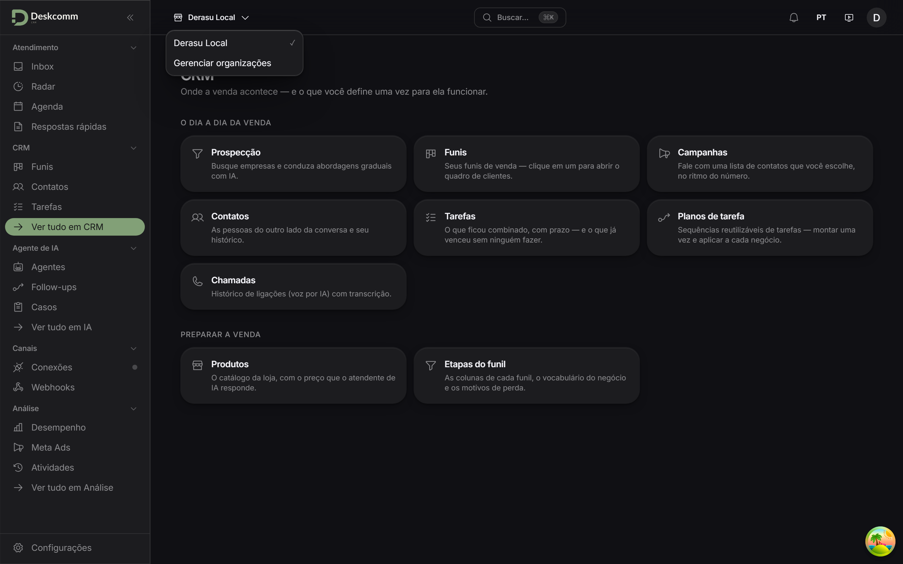

### app-inbox_desktop_escuro_sem-transparencia

tema `dark`; transparência reduzida: sim; fonte "Inter Derasu"; sem cartão; barra lateral `rgb(28, 28, 31)` / `none`.

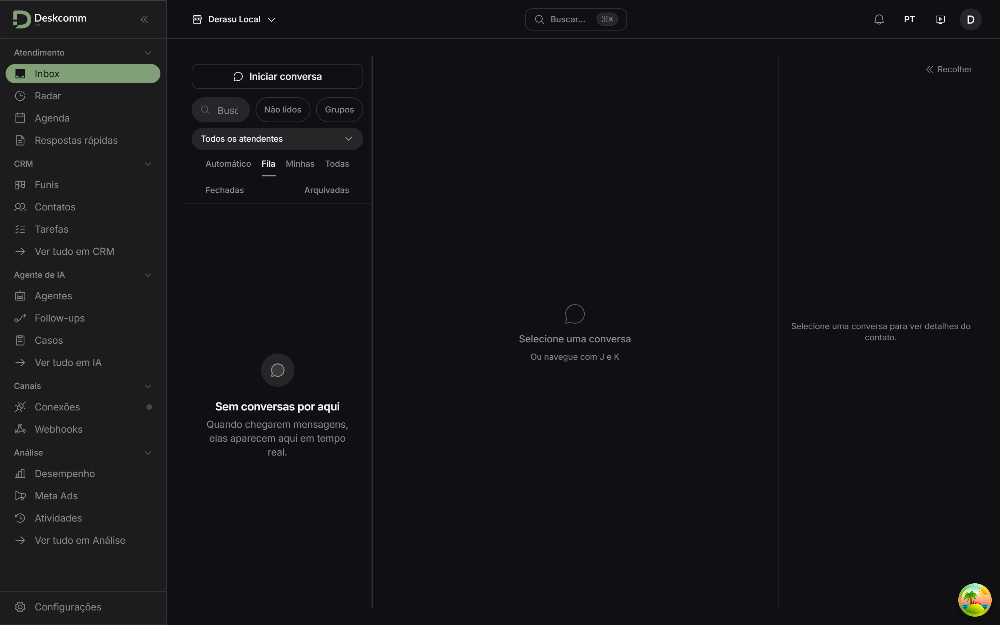

### app-crm_celular_claro_vidro

tema `light`; transparência reduzida: não; fonte "Inter Derasu"; cartão `rgb(255, 255, 255)`; barra lateral `rgba(250, 250, 253, 0.6)` / `blur(22px) saturate(1.9)`.

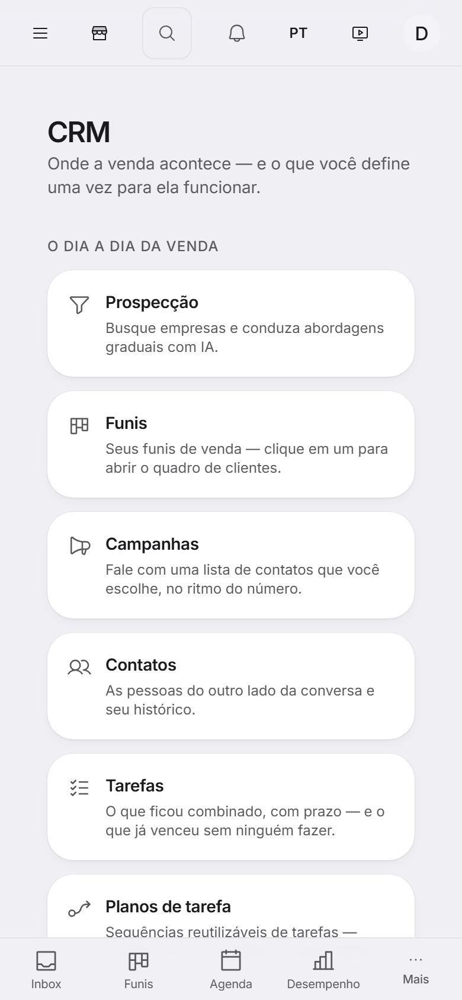

### app-inbox_celular_claro_vidro

tema `light`; transparência reduzida: não; fonte "Inter Derasu"; sem cartão; barra lateral `rgba(250, 250, 253, 0.6)` / `blur(22px) saturate(1.9)`.

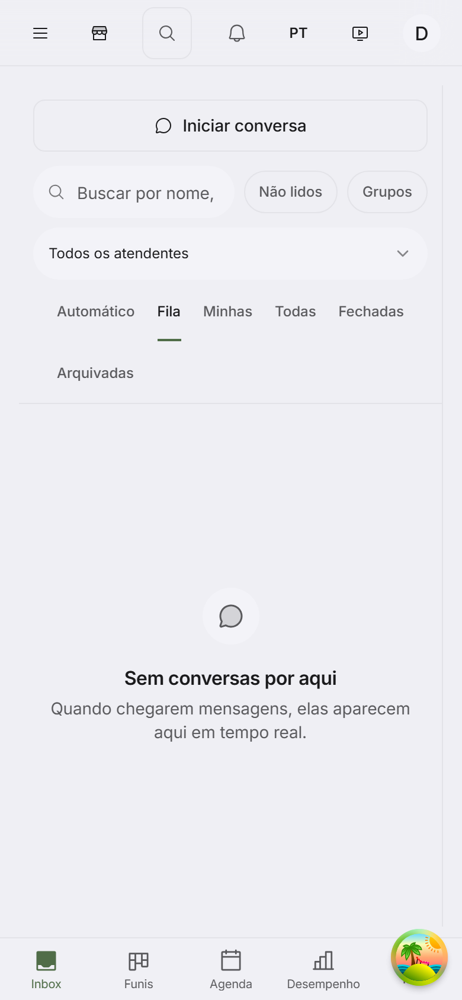

### app-crm_celular_claro_sem-transparencia

tema `light`; transparência reduzida: sim; fonte "Inter Derasu"; cartão `rgb(255, 255, 255)`; barra lateral `rgb(255, 255, 255)` / `none`.

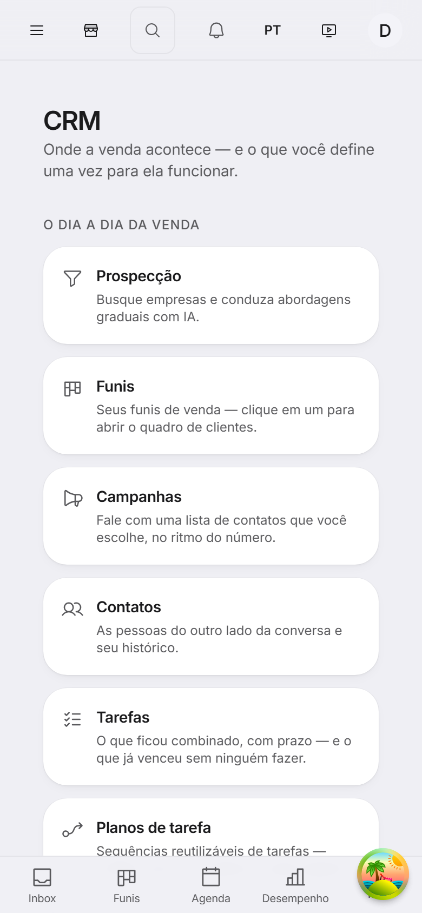

### app-inbox_celular_claro_sem-transparencia

tema `light`; transparência reduzida: sim; fonte "Inter Derasu"; sem cartão; barra lateral `rgb(255, 255, 255)` / `none`.

### app-crm_celular_escuro_vidro

tema `dark`; transparência reduzida: não; fonte "Inter Derasu"; cartão `rgb(28, 28, 31)`; barra lateral `rgba(30, 30, 36, 0.56)` / `blur(22px) saturate(1.9)`.

### app-inbox_celular_escuro_vidro

tema `dark`; transparência reduzida: não; fonte "Inter Derasu"; sem cartão; barra lateral `rgba(30, 30, 36, 0.56)` / `blur(22px) saturate(1.9)`.

### app-crm_celular_escuro_sem-transparencia

tema `dark`; transparência reduzida: sim; fonte "Inter Derasu"; cartão `rgb(28, 28, 31)`; barra lateral `rgb(28, 28, 31)` / `none`.

### app-inbox_celular_escuro_sem-transparencia

tema `dark`; transparência reduzida: sim; fonte "Inter Derasu"; sem cartão; barra lateral `rgb(28, 28, 31)` / `none`.

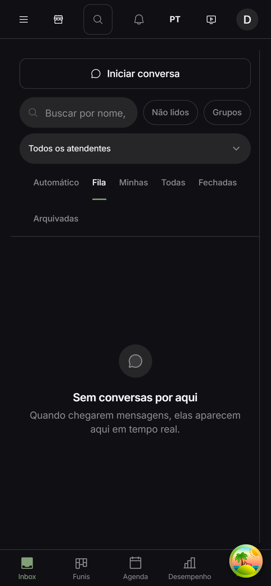
