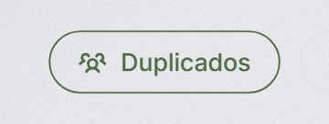
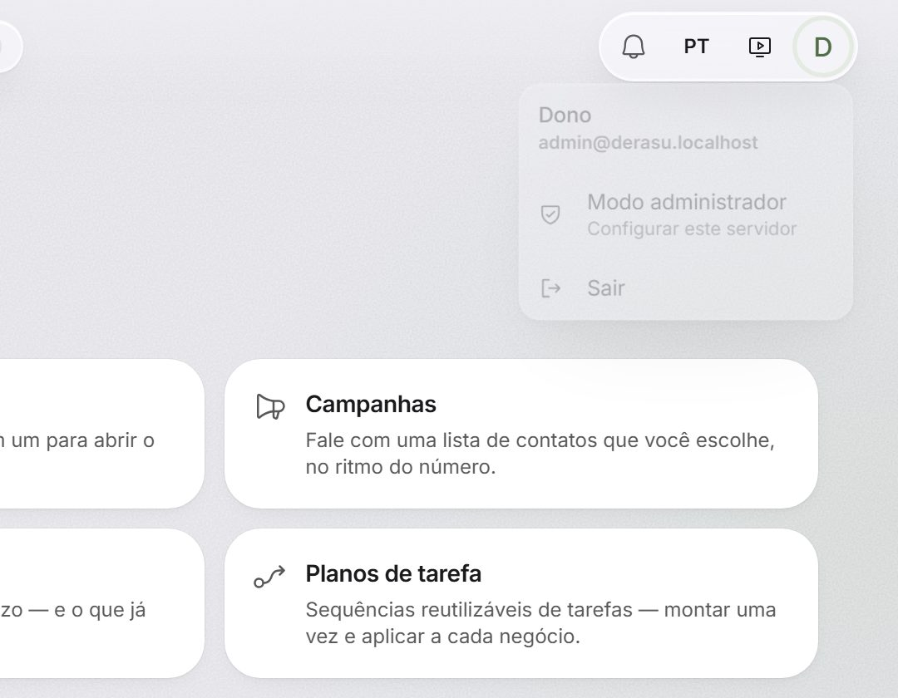
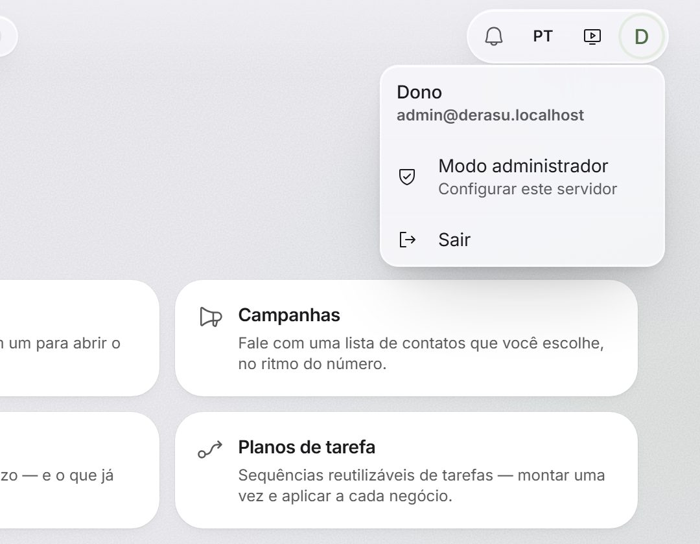
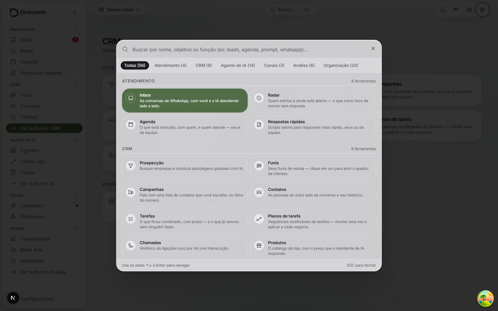
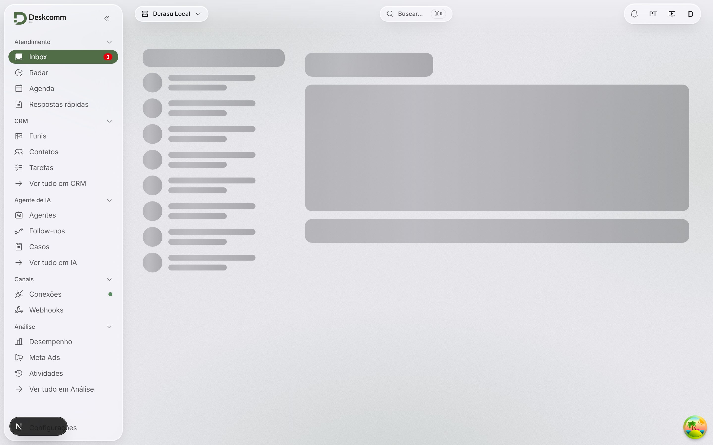
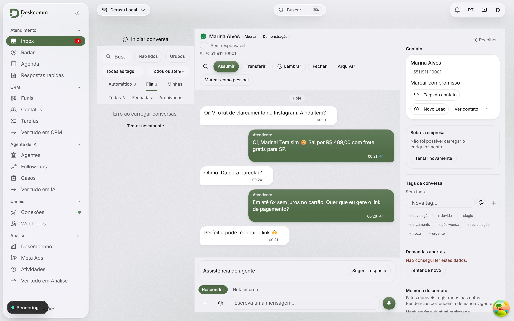
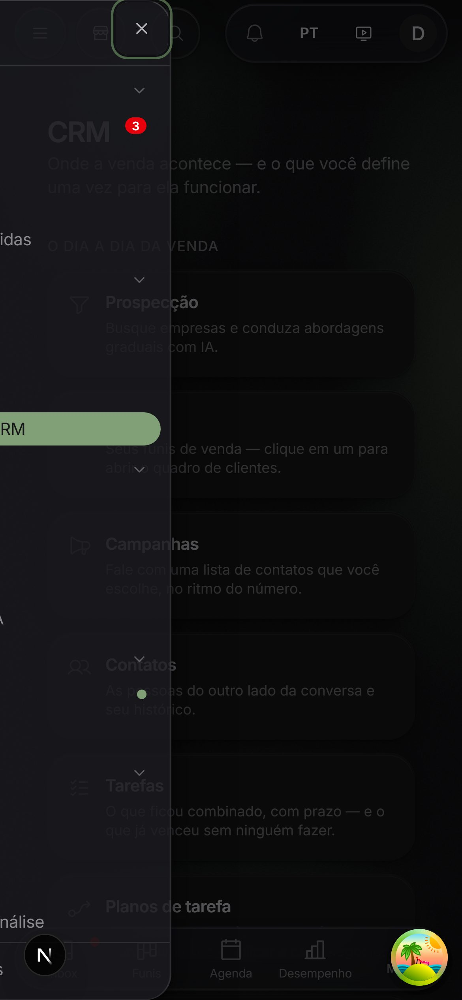
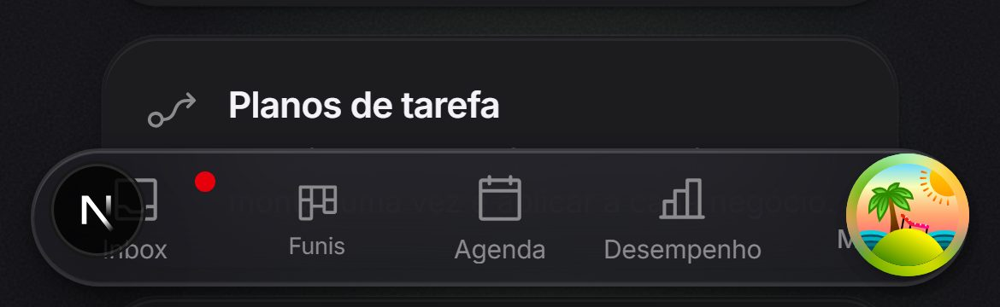

# Prova de movimento — Derasu, entrega 5

Gerada por `derasu/scripts/prova-de-movimento.mjs`. As medidas (valor da propriedade
animada amostrado em vários instantes) estão em [`medidas.json`](medidas.json); as fotos do
meio de cada animação foram tiradas com o relógio de animações do Chrome desacelerado.

## Botão pressionado: encolhe para 96% enquanto está seguro

## Menu no meio da abertura (relógio a 8%): cresce a partir do botão que o abriu

## Menu assentado

## Paleta de comandos (modal) assentada depois da entrada em mola

## Troca de área no meio (relógio a 10%): a página do CRM esmaece e a inbox sobe 8px

## Inbox depois da troca de área, assentada

## Gaveta de navegação no meio da entrada (relógio a 8%), sem passar da borda

## Aba da barra inferior pressionada: encolhe para 90%

